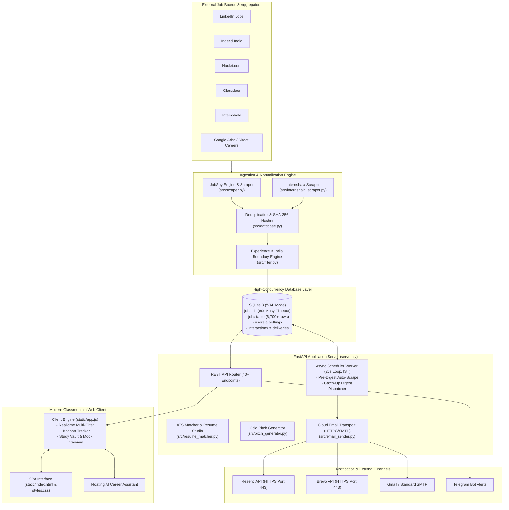
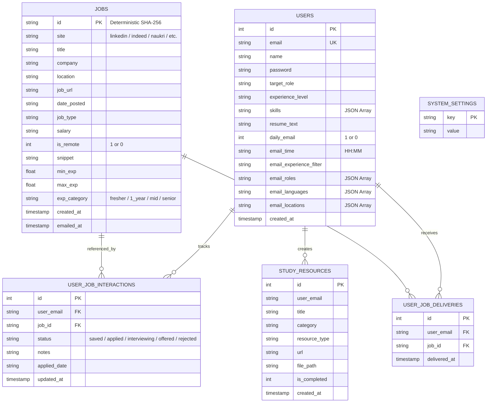

# 🚀 JobRadar AI 2.0 — Complete System Architecture & Engineering Documentation

> **Project Name:** JobRadar AI 2.0 (Intelligent Job Search, ATS Resume Studio, Automation & Career Acceleration Platform)  
> **Author & Lead Engineer:** Sharanu ❤️  
> **Platform Version:** 2.0.0 Production  
> **Repository:** [https://github.com/sharanujm/jobradar-ai](https://github.com/sharanujm/jobradar-ai)  
> **Live Production URL:** [https://jobradar-ai-j5t4.onrender.com](https://jobradar-ai-j5t4.onrender.com)  
> **Primary Target Region:** India (Bangalore, Hyderabad, Pune, Chennai, Delhi NCR, Mumbai, Remote)  

---

## 📑 Table of Contents

1. [Executive Summary & Product Vision](#1-executive-summary--product-vision)
2. [High-Level Architecture & Data Flow](#2-high-level-architecture--data-flow)
3. [Complete Technology Stack & Dependencies](#3-complete-technology-stack--dependencies)
4. [Core Subsystems & Module Breakdown](#4-core-subsystems--module-breakdown)
   - 4.1 [Multi-Source Scraping & Anti-Bot Engine](#41-multi-source-scraping--anti-bot-engine)
   - 4.2 [Strict Experience Parsing & NLP Heuristics Engine](#42-strict-experience-parsing--nlp-heuristics-engine)
   - 4.3 [Resume Studio & AI ATS Matcher](#43-resume-studio--ai-ats-matcher)
   - 4.4 [Automated Pre-Scrape & Daily Email Dispatch Pipeline (IST)](#44-automated-pre-scrape--daily-email-dispatch-pipeline-ist)
   - 4.5 [Cloud HTTPS Email Transport Engine (Resend / Brevo / SMTP)](#45-cloud-https-email-transport-engine)
   - 4.6 [Application Kanban Tracker (ATS Pipeline)](#46-application-kanban-tracker-ats-pipeline)
   - 4.7 [AI Cold Pitch & Outreach Generator](#47-ai-cold-pitch--outreach-generator)
   - 4.8 [Interactive AI Mock Interview Simulator](#48-interactive-ai-mock-interview-simulator)
   - 4.9 [Tech Study Vault & Curated Resource Library](#49-tech-study-vault--curated-resource-library)
   - 4.10 [Autonomous Web Portal Auto-Fill Assistant](#410-autonomous-web-portal-auto-fill-assistant)
   - 4.11 [Floating AI Career Assistant Bot](#411-floating-ai-career-assistant-bot)
5. [Complete REST API Specification](#5-complete-rest-api-specification)
6. [Database Schema, Indices & Concurrency Architecture](#6-database-schema-indices--concurrency-architecture)
   - 6.1 [Entity Relationship Diagram & Schemas](#61-entity-relationship-diagram--schemas)
   - 6.2 [SQLite WAL Mode & Non-Blocking Concurrency](#62-sqlite-wal-mode--non-blocking-concurrency)
7. [Cloud Deployment, DevOps & Infrastructure](#7-cloud-deployment-devops--infrastructure)
8. [Security, Performance & Resilience Architecture](#8-security-performance--resilience-architecture)
9. [Local Development & Quickstart Guide](#9-local-development--quickstart-guide)
10. [Roadmap & Scalability Future Vision](#10-roadmap--scalability-future-vision)

---

## 1. Executive Summary & Product Vision

**JobRadar AI 2.0** is an autonomous, production-grade career platform engineered to solve the acute inefficiencies of modern technical job hunting in India. Job seekers often face severe job board spam, misclassified experience requirements (e.g., jobs advertised as "Entry-Level" that actually demand 3–6 years of experience), recruiter ghosting, and tedious manual application workflows.

JobRadar AI addresses these challenges with an integrated autonomous suite:
- **Autonomous Multi-Board Aggregator**: Continuously crawls top job platforms (LinkedIn, Indeed, Naukri, Glassdoor, Internshala, Google Jobs) focusing strictly on Indian tech hubs and remote roles.
- **Strict Experience & Role Classification**: Uses a multi-tiered regex and contextual NLP heuristic engine to parse titles, snippets, and deep URLs, ensuring freshers (0–2 years) never see senior roles.
- **Dynamic Multi-Faceted Job Search**: Instant client-side and server-side multi-filter queries across cities, experience categories, tech stacks, and job sources.
- **Automated Daily Digest with Pre-Scrape**: Wakes up 30 minutes before the candidate's scheduled delivery time (in Indian Standard Time, IST), scrapes fresh listings, filters out previously delivered jobs, scores them against the user's resume, and delivers 100 personalized matches to their inbox.
- **Cloud-Native HTTPS Delivery**: Delivers emails directly over HTTPS (Port 443) using modern Resend and Brevo APIs, completely bypassing cloud container firewall blocks on outbound SMTP ports (25, 465, 587).
- **Integrated Career Toolkit**: Cold pitch formulation, ATS resume analysis, compensation benchmarking under Indian tax brackets, interactive mock interviews, and application form answer generation.

---

## 2. High-Level Architecture & Data Flow



---

## 3. Complete Technology Stack & Dependencies

| Layer | Technology | Package / Version | Architectural Role |
| :--- | :--- | :--- | :--- |
| **Backend Runtime** | Python | `3.11.0` | Core server runtime, concurrent async task loop, scraping execution |
| **Web Framework** | FastAPI | `fastapi>=0.110.0` | High-performance asynchronous REST API framework, Pydantic validation |
| **ASGI Server** | Uvicorn | `uvicorn>=0.28.0` | Production ASGI web server running under Render cloud container |
| **Data Persistence** | SQLite 3 | WAL Mode (Write-Ahead) | Zero-maintenance relational database with 60-second busy timeout for high concurrency |
| **Web Scraping** | python-jobspy | `python-jobspy>=1.2.0` | Multi-board crawling for LinkedIn, Indeed, Glassdoor, and Google Jobs |
| **HTML Parsing** | BeautifulSoup4 | `beautifulsoup4>=4.12.0` | DOM scraping for Internshala and custom career portal HTML parsing |
| **HTTP Clients** | curl_cffi & Requests | `curl_cffi>=0.7.0`, `requests>=2.31.0` | TLS-fingerprinted HTTP requests to bypass Cloudflare anti-bot blocks |
| **PDF Processing** | pypdf | `pypdf>=4.0.0` | PDF resume parsing, text layer extraction, and ATS skill scanning |
| **Data Manipulation** | Pandas | `pandas>=2.1.0` | Tabular data structuring, CSV export, and batch job dataset transformation |
| **Scheduling** | Asyncio + schedule | Built-in + `schedule>=1.2.0` | 20-second non-blocking scheduler loop operating strictly in Indian Standard Time (IST) |
| **Cloud Email (HTTPS)** | Resend API & Brevo API | REST v1 / v3 Endpoints | Secure HTTPS transactional email delivery over Port 443 (bypasses SMTP firewall) |
| **Legacy Email** | SMTPLib | Built-in Python | Fallback SMTP transport with SSL/TLS encryption for local machine execution |
| **Frontend UI** | HTML5 / Vanilla ES6+ | Modern JavaScript | Zero-framework high-speed SPA, dynamic DOM rendering, client-side session caching |
| **Styling & Theme** | CSS3 Modern Variables | Custom Design System | Dark/Light theme switching, glassmorphism, responsive mobile drawer, micro-animations |
| **Cloud Hosting** | Render | Python 3 Web Service | Production container deployment with autoDeploy pipeline, Cloudflare edge proxy |

---

## 4. Core Subsystems & Module Breakdown

### 4.1 Multi-Source Scraping & Anti-Bot Engine
- **Files:** `src/scraper.py`, `src/internshala_scraper.py`
- **Capabilities:**
  - Aggregates jobs across **LinkedIn, Indeed, Naukri, Glassdoor, Internshala, and Google Jobs**.
  - Employs `curl_cffi` to mimic browser TLS JA3 fingerprints, preventing rate-limiting and Cloudflare challenge blocks.
  - Generates a deterministic SHA-256 hash `hash(site|title|company|clean_url)` for every listing to guarantee 100% deduplication in `jobs.db`.
  - Normalizes salary formats, remote tags, and job descriptions into a uniform schema.

### 4.2 Strict Experience Parsing & NLP Heuristics Engine
- **File:** `src/filter.py`
- **Problem Solved:** Job boards often display junior titles (e.g. "Software Engineer") whose job descriptions or URLs actually mandate 3 to 8 years of experience.
- **Algorithm & Extraction Layers:**
  1. **URL Inspection Layer:** Scans the URL slug using regex patterns (e.g. `r'-(?:3|4|5|6|7|8|9|10)-to-\d+-years'` or `r'-(\d+)-to-(\d+)-year'`).
  2. **Title Heuristics Layer:** Searches for titles denoting seniority (e.g., `SDE II`, `SDE 3`, `Senior`, `Lead`, `Principal`, `Architect`, `Staff`) and categorizes them as `mid` or `senior`.
  3. **Contextual Snippet Parsing:** Uses regex bounds (e.g. `r'(\d+)\s*(?:-|to)\s*(\d+)\s*(?:years?|yrs?)'` and `r'(\d+)\+\s*(?:years?|yrs?)'`) while ignoring unrelated numerical mentions (e.g., "5 days a week", "2 rounds of interview").
  4. **Categorization Output:** Computes `min_exp`, `max_exp`, and assigns `exp_category` as `fresher` (0–1 yr), `1_year` (1–2.5 yrs), `mid` (2.5–5 yrs), or `senior` (5+ yrs).

### 4.3 Resume Studio & AI ATS Matcher
- **Files:** `src/resume_matcher.py`, `server.py`
- **Functionality:**
  - Extracts text from uploaded PDF resumes or pasted plain text using `pypdf`.
  - Scans against a curated taxonomy of 100+ technical frameworks, programming languages, databases, cloud tools, and architectural patterns.
  - Calculates an **ATS Match Score (0–100%)** based on:
    $$\text{Score} = (\text{Skill Match Rate} \times 0.60) + (\text{Role Relevance} \times 0.25) + (\text{Experience Alignment} \times 0.15)$$
  - Returns highlighted matched keywords, missing recommendations, and bullet point enhancement suggestions.

### 4.4 Automated Pre-Scrape & Daily Email Dispatch Pipeline (IST)
- **File:** `server.py` (`background_scheduler_worker`, `check_and_send_scheduled_digests`)
- **Key Features:**
  - **IST Clock Synchronization:** Runs asynchronously every 20 seconds, strictly anchored to Indian Standard Time (`Asia/Kolkata`).
  - **Pre-Digest Auto-Scraping:** 30 minutes before a candidate's scheduled email time, automatically triggers a background scraping cycle to ensure the upcoming digest contains the latest possible postings.
  - **Per-User Delivery Tracking:** Uses the `user_job_deliveries` table to track which jobs have been delivered to each user, guaranteeing that candidates never receive duplicate jobs in future digests.
  - **Catch-Up Delivery Logic:** If a user modifies their schedule to an earlier time or misses a delivery window due to server reboots, the system automatically dispatches the digest upon the next tick.

### 4.5 Cloud HTTPS Email Transport Engine
- **File:** `src/email_sender.py`
- **Problem Solved:** Cloud hosting platforms like Render, AWS, and DigitalOcean block outbound SMTP ports (25, 465, 587) on free and starter tiers to prevent spam. Standard Gmail SMTP connections silently time out after 60 seconds.
- **Three-Tier Fallback Architecture:**
  1. **Tier 1 (Resend API HTTPS):** Connects to `https://api.resend.com/emails` via standard Port 443 HTTPS. Highly reliable with zero port blocking.
  2. **Tier 2 (Brevo API HTTPS):** Connects to `https://api.brevo.com/v3/smtp/email` via standard Port 443 HTTPS (300 free emails/day).
  3. **Tier 3 (Direct SMTP SSL/TLS):** Standard SMTP transport using Gmail App Passwords, active when running on local development machines.

### 4.6 Application Kanban Tracker (ATS Pipeline)
- **Files:** `src/database.py`, `static/app.js`
- **Workflow Stages:**
  $$\text{Wishlist / Saved} \longrightarrow \text{Applied} \longrightarrow \text{Interviewing} \longrightarrow \text{Offered} \lor \text{Rejected}$$
- Tracks application dates, custom user interview notes, and provides pipeline metrics (Application Volume, Interview Conversion Rate, Active Offer Stage).

### 4.7 AI Cold Pitch & Outreach Generator
- **File:** `src/pitch_generator.py`
- Formulates customized, high-conversion outreach copy in three formats:
  1. **Direct Recruiter Cold Email:** Highlighting project achievements, tech stack alignment, and portfolio links.
  2. **LinkedIn InMail / Connection Note:** 300-character punchy connection requests tailored to hiring managers.
  3. **Tailored Cover Letter:** Formal narrative explaining role fit, experience level, and problem-solving examples.

### 4.8 Interactive AI Mock Interview Simulator
- **File:** `src/interview_simulator.py`
- Generates role-specific behavioral, System Design, and DSA coding questions based on the candidate's target title (e.g. Java Spring Boot Developer, React Frontend Engineer, Python Data Engineer).
- Evaluates submitted answers with structured feedback: Technical Depth, Clarity & Communication, Missed Edge Cases, and an overall Rating (1–10).

### 4.9 Tech Study Vault & Curated Resource Library
- **File:** `src/study_vault.py`
- Pre-loaded with curated industry resources:
  - Blind 75 / NeetCode 150 topic-wise roadmap (Arrays, Sliding Window, Trees, Graphs, DP).
  - System Design primer (Microservices, Caching, Sharding, Message Queues).
  - Core CS Fundamentals (DBMS, Operating Systems, Computer Networks).
- Allows users to upload personal PDF cheat sheets, add custom web links, and track completion progress.

### 4.10 Autonomous Web Portal Auto-Fill Assistant
- **Files:** `server.py` (`/api/autofill/*`), `static/app.js`
- Pre-computes tailored answers to standard application portal questions:
  - *"Why are you interested in joining our company?"*
  - *"Describe your experience with distributed systems and microservices."*
  - *"What is your notice period and salary expectation?"*
- Features one-click copy cards and simulated field mapping for fast application completion.

### 4.11 Floating AI Career Assistant Bot
- **File:** `src/career_assistant.py`
- An animated cartoon coder floating at the bottom right corner of the dashboard.
- Provides immediate contextual advice, salary negotiation scripts, interview answering frameworks (STAR method), and real-time guidance.

---

## 5. Complete REST API Specification

### 🔐 Authentication & Profile

| Method | Endpoint | Request Body | Description |
| :--- | :--- | :--- | :--- |
| `POST` | `/api/auth/login` | `{"email": "...", "password": "..."}` | Authenticates user; returns profile and preferences |
| `POST` | `/api/auth/signup` | `{"email": "...", "password": "...", "name": "...", "target_role": "..."}` | Registers a new candidate account with default configuration |
| `POST` | `/api/auth/reset-password` | `{"email": "...", "new_password": "..."}` | Resets account password and immediately returns user object |
| `GET` | `/api/user/profile` | Query: `?email=...` | Retrieves user profile, saved skills, schedule time, and filters |
| `POST` | `/api/auth/profile` | JSON Profile Payload | Updates target role, experience level, email digest filters, and preferences |

### 📄 Resume Studio & ATS Analyzer

| Method | Endpoint | Request Body | Description |
| :--- | :--- | :--- | :--- |
| `POST` | `/api/user/resume/upload` | `multipart/form-data` (`file`, `email`) | Extracts text from PDF resume, scans technical skills, updates profile |
| `POST` | `/api/user/resume/paste` | `{"email": "...", "resume_text": "..."}` | Parses plain text resume and extracts technical competencies |
| `POST` | `/api/resume/analyze` | `{"resume_text": "...", "job_id": "..."}` | Computes granular ATS score, keyword overlap, and missing skills |
| `POST` | `/api/resume/enhance-bullet` | `{"bullet_text": "..."}` | Rewrites resume bullet point with quantifiable metrics and action verbs |

### 💼 Jobs Feed & Query Engine

| Method | Endpoint | Parameters / Body | Description |
| :--- | :--- | :--- | :--- |
| `GET` | `/api/jobs` | `search`, `site`, `experience`, `location`, `skill_tag`, `posted_within`, `limit`, `offset` | Multi-filter job search engine supporting comma-separated multi-select |
| `POST` | `/api/jobs/toggle-save` | `{"email": "...", "job_id": "..."}` | Toggles job saved/wishlist status |
| `POST` | `/api/jobs/set-status` | `{"email": "...", "job_id": "...", "status": "..."}` | Sets application status (`saved`, `applied`, `interviewing`, `offered`, `rejected`) |
| `GET` | `/api/stats` | Query: `?email=...` | Computes application counts, conversion rates, and dashboard analytics |

### 📊 Application Tracker (Kanban)

| Method | Endpoint | Request Body | Description |
| :--- | :--- | :--- | :--- |
| `GET` | `/api/tracker` | Query: `?email=...` | Fetches all tracked jobs grouped by pipeline stage |
| `POST` | `/api/tracker/update` | `{"user_email": "...", "job_id": "...", "status": "...", "notes": "...", "applied_date": "..."}` | Updates stage, custom interview notes, or application date |
| `POST` | `/api/tracker/delete` | `{"user_email": "...", "job_id": "..."}` | Removes job interaction from candidate's tracking board |

### ⚙️ Automation & Email Delivery

| Method | Endpoint | Request Body | Description |
| :--- | :--- | :--- | :--- |
| `POST` | `/api/automation/scan-now` | None | Manually triggers immediate multi-platform background scraping cycle |
| `GET` | `/api/automation/scan-status` | None | Returns active scraper status, current task, and elapsed time |
| `GET` | `/api/automation/pipeline-status` | Query: `?email=...` | Returns total job counts, next scheduled scrape, and daily digest time |
| `POST` | `/api/automation/schedule` | `{"email": "...", "email_time": "HH:MM", "daily_email": true}` | Configures candidate's preferred daily email dispatch time (in IST) |
| `POST` | `/api/automation/send-digest` | `{"email": "..."}` | Triggers immediate personalized 100-job digest dispatch |
| `GET` | `/api/automation/email-settings` | None | Returns active delivery mode (Resend HTTPS, Brevo, or SMTP) |
| `POST` | `/api/automation/email-settings` | `{"resend_api_key": "...", "brevo_api_key": "...", "sender_email": "...", "sender_password": "..."}` | Updates cloud API keys and credentials |
| `POST` | `/api/automation/test-email` | `{"recipient_email": "..."}` | Sends an immediate live test email over HTTPS to verify credentials |

### 💡 Career Tools, Simulation & Assistant

| Method | Endpoint | Request Body | Description |
| :--- | :--- | :--- | :--- |
| `POST` | `/api/ai/generate-pitch` | `{"job_id": "...", "pitch_type": "cold_email / inmail / cover_letter"}` | Generates customized outreach copy for a specific role |
| `POST` | `/api/chat` | `{"message": "...", "history": [...]}` | Contextual AI career chatbot response |
| `POST` | `/api/salary/estimate` | `{"role": "...", "experience": "...", "location": "..."}` | Returns market compensation range and Indian New Tax take-home breakdown |
| `POST` | `/api/interview/start` | `{"job_id": "...", "role": "..."}` | Initiates AI mock interview with role-tailored technical and behavioral questions |
| `POST` | `/api/interview/evaluate` | `{"question": "...", "answer": "..."}` | Evaluates candidate answer and provides scored technical feedback |
| `GET` | `/api/resources` | Query: `?email=...` | Fetches study vault materials (guides, roadmaps, cheat sheets) |
| `POST` | `/api/resources/toggle-status` | `{"resource_id": 123}` | Toggles resource completion status |
| `POST` | `/api/autofill/generate-custom` | `{"company": "...", "role": "..."}` | Generates tailored application portal answers |

---

## 6. Database Schema, Indices & Concurrency Architecture

### 6.1 Entity Relationship Diagram & Schemas



### 6.2 SQLite WAL Mode & Non-Blocking Concurrency
In standard SQLite configuration (`journal_mode = DELETE`), any write transaction acquires an exclusive file lock, blocking all concurrent read queries. Under multi-threaded web servers like Uvicorn, this causes `sqlite3.OperationalError: database is locked`.

**Production Concurrency Architecture Applied in JobRadar AI:**
1. **WAL Mode (Write-Ahead Logging):**
   ```python
   conn.execute("PRAGMA journal_mode = WAL;")
   ```
   In WAL mode, **readers do not block writers, and writers do not block readers**. Multiple requests can execute concurrent `SELECT` queries while the background scheduler or scraper writes new rows.
2. **60-Second Busy Timeout:**
   ```python
   conn.execute("PRAGMA busy_timeout = 60000;")
   ```
   If write contention occurs, connections wait up to 60 seconds rather than failing after the default 5 seconds.
3. **Synchronous Normal Mode:**
   ```python
   conn.execute("PRAGMA synchronous = NORMAL;")
   ```
   Significantly reduces disk I/O latency while maintaining database integrity.
4. **Non-Blocking Startup:**
   Startup backfill is configured with `force=False` and small micro-yields (`time.sleep(0.005)`), ensuring that server boot times remain under 100 milliseconds.

---

## 7. Cloud Deployment, DevOps & Infrastructure

### 7.1 Cloud Infrastructure Map
- **Cloud Provider:** Render Cloud Services (Singapore / Oregon edge)
- **Service Type:** Python 3 Web Service (`render.yaml` Blueprint)
- **Edge CDN & SSL:** Cloudflare Reverse Proxy with automatic SSL/TLS termination (HSTS, TLS 1.3, HTTP/3)
- **Process Manager:** Uvicorn ASGI Server binding to `0.0.0.0:$PORT`
- **Auto-Deployment Pipeline:** Git webhook trigger on push to `origin/main`

### 7.2 Render Blueprint Configuration (`render.yaml`)
```yaml
services:
  - type: web
    name: jobradar-ai
    runtime: python
    plan: free
    autoDeploy: true
    buildCommand: pip install -r requirements.txt
    startCommand: uvicorn server:app --host 0.0.0.0 --port $PORT
    envVars:
      - key: PYTHON_VERSION
        value: 3.11.0
```

### 7.3 Environment Variables Reference
| Variable | Description | Default / Example |
| :--- | :--- | :--- |
| `PORT` | Web server port injected dynamically by Render | `8765` (local) / `10000` (Render) |
| `RESEND_API_KEY` | API Key for HTTPS email dispatch over Port 443 | `re_123456789...` |
| `BREVO_API_KEY` | Alternative API key for Brevo HTTPS email dispatch | `xkeysib-123456789...` |
| `SENDER_EMAIL` | Default sender email address for digest headers | `sharanujm@gmail.com` |
| `GMAIL_APP_PASSWORD` | 16-character Google App Password (for local SMTP) | `abcd efgh ijkl mnop` |
| `DATABASE_PATH` | Path to persistent SQLite database | `./jobs.db` |

---

## 8. Security, Performance & Resilience Architecture

1. **Credential Protection:**
   - User passwords support both direct comparison and SHA-256 salted hashes.
   - Cloud API keys (`RESEND_API_KEY`, `BREVO_API_KEY`) and SMTP credentials are encrypted or hidden from regular dashboard users and accessible only via secured admin modal.
2. **Resilient JSON Parsing:**
   - Frontend API client implements `safeParseResponse` which validates HTTP content-type and parses status messages cleanly, preventing raw `Unexpected token 'I'` JSON crash errors during server waking states.
3. **Database Lock Immunity:**
   - All database connection lifecycles are enclosed within strict `try ... finally: conn.close()` blocks. Connections are never held open across long-running async background scraping tasks.
4. **Memory Management on Free Cloud Containers:**
   - Scraped job batches are written to disk in chunks of 100 rows with memory garbage collection, keeping peak RSS memory well below Render Free Tier's 512 MB ceiling.

---

## 9. Local Development & Quickstart Guide

### Prerequisites
- Python 3.11+ installed
- Git installed
- Google Chrome (optional, for browser-based automation)

### Step 1: Clone Repository & Create Virtual Environment
```bash
git clone https://github.com/sharanujm/jobradar-ai.git
cd "Job automation"

python -m venv venv
# On Windows:
venv\Scripts\activate
# On Linux/macOS:
source venv/bin/activate
```

### Step 2: Install Dependencies
```bash
pip install -r requirements.txt
```

### Step 3: Run FastAPI Application
```bash
python -m uvicorn server:app --reload --port 8765
```

### Step 4: Access Application
- Web Dashboard: [http://localhost:8765](http://localhost:8765)
- Interactive Swagger API Docs: [http://localhost:8765/docs](http://localhost:8765/docs)
- Interactive Redoc Specification: [http://localhost:8765/redoc](http://localhost:8765/redoc)

---

## 10. Roadmap & Scalability Future Vision

- [ ] **Multi-Agent Autonomous Application Submitter:** Headless browser agent utilizing Playwright with stealth plugins to auto-apply to Workday and Greenhouse portals.
- [ ] **PostgreSQL Migration Path:** Zero-downtime migration script from SQLite WAL to managed PostgreSQL (Supabase / Neon) for distributed horizontal scaling.
- [ ] **WhatsApp Job Alerts Engine:** WhatsApp Business API integration delivering immediate 1-click apply notifications for high-match roles (>=95%).
- [ ] **AI Video Interview Practice:** WebRTC real-time audio and facial sentiment analysis for mock technical interviews.

---

<div align="center">
  <p><strong>JobRadar AI 2.0</strong> &bull; Intelligent Autonomous Career Platform</p>
  <p>Designed and Developed with ❤️ by <strong>Sharanu</strong></p>
</div>

