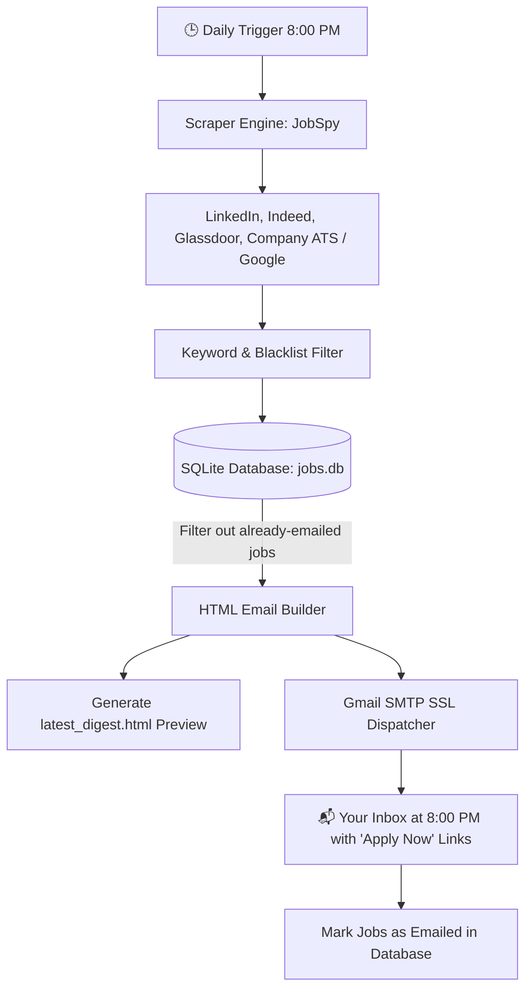

# 🤖 Automated Job Hunter & Daily 8:00 PM Email Digest

This tool automates your job search so you never have to manually browse job boards. Every day, it finds matching Software Engineer / Developer roles across **LinkedIn, Indeed, Glassdoor, and Company Career Pages (Google Jobs)**, filters them according to your preferences, deduplicates them in a local database, and delivers a curated email digest with direct **"Apply Now"** links directly to your inbox every night at **8:00 PM**.

---

## 📌 Table of Contents
1. [Which Email ID Will Receive the Notifications?](#1-which-email-id-will-receive-the-notifications)
2. [How the System Works (Architecture)](#2-how-the-system-works)
3. [Step-by-Step Setup Guide](#3-step-by-step-setup-guide)
   - [Step 1: Configure Your Email (.env)](#step-1-configure-your-email-env)
   - [Step 2: Test Email Delivery (2 Seconds)](#step-2-test-email-delivery)
   - [Step 3: Run the Scraper Right Now](#step-3-run-the-scraper-right-now)
   - [Step 4: Enable Automatic 8:00 PM Daily Schedule](#step-4-enable-automatic-800-pm-daily-schedule)
4. [Customizing Keywords & Locations](#4-customizing-keywords--locations)
5. [File Structure](#5-file-structure)

---

## 1. Which Email ID Will Receive the Notifications?

**You control which email receives the jobs!** 

In the [.env](file:///d:/Job%20automation/.env) file located in your project root, you set:

```env
# The Gmail address that sends the emails (using a free Google App Password)
SENDER_EMAIL=your_email@gmail.com
SENDER_APP_PASSWORD=your_16_character_app_password

# The Email address where YOU want to receive the daily job digest
RECIPIENT_EMAIL=your_email@gmail.com
```

> **Note:** `RECIPIENT_EMAIL` can be the **same Gmail account** or **any other email account** (e.g. your personal Gmail, Outlook, Yahoo, or work email).

---

## 2. How the System Works



### Key Highlights:
1. **Multi-Source Aggregation**: Fetches listings from LinkedIn, Indeed, Glassdoor, and Google Jobs without needing API keys or paid subscriptions.
2. **Zero Duplicate Spam**: Every job is hashed and tracked in [jobs.db](file:///d:/Job%20automation/jobs.db). Once a job is emailed to you, it will never be emailed again.
3. **Smart Filters**: Filters out irrelevant positions (e.g., Senior Directors, Hardware, Sales) and keeps relevant roles (SDE, Full Stack, Backend, Python, etc.).
4. **Instant Browser Preview**: Always creates a local [latest_digest.html](file:///d:/Job%20automation/latest_digest.html) so you can review the jobs in your browser at any time.

---

## 3. Step-by-Step Setup Guide

### Step 1: Configure Your Email (.env)
Since Google disabled basic password logins for security, you need a free **16-character Google App Password** (takes ~60 seconds):

1. Go to your Google Account Security: **https://myaccount.google.com/security**
2. Ensure **2-Step Verification** is turned ON.
3. In the search bar at the top, search for **App Passwords** (or visit **https://myaccount.google.com/apppasswords**).
4. Enter an App Name (e.g., `Job Hunter`) and click **Create**.
5. Google will display a 16-character code (e.g., `abcd efgh ijkl mnop`).
6. Open your [.env](file:///d:/Job%20automation/.env) file in this folder and paste it:
   ```env
   SENDER_EMAIL=your_actual_gmail@gmail.com
   SENDER_APP_PASSWORD=abcdefghijklmnop
   RECIPIENT_EMAIL=your_actual_gmail@gmail.com
   ```

---

### Step 2: Test Email Delivery (Takes 2 Seconds)
Before running a full scrape, verify that your email credentials work:

Open PowerShell in `d:\Job automation` and run:
```powershell
.\venv\Scripts\python test_email.py
```
If configured correctly, you will receive a test job digest in your inbox immediately!

---

### Step 3: Run the Scraper Right Now (On-Demand)
To find all current matching jobs right away without waiting for 8:00 PM:

```powershell
.\venv\Scripts\python run_now.py
```
This will:
- Scrape LinkedIn, Indeed, Glassdoor, and Google Jobs
- Filter matching Software Developer roles in India & Remote
- Save new jobs to [jobs.db](file:///d:/Job%20automation/jobs.db)
- Create [latest_digest.html](file:///d:/Job%20automation/latest_digest.html)
- Send the email digest with all apply links to your `RECIPIENT_EMAIL`

---

### Step 4: Enable Automatic 8:00 PM Daily Schedule

You have **two options** to run it daily at 8:00 PM:

#### Option A: Native Windows Task Scheduler (Recommended - Set & Forget)
This is the best option because **it runs silently in the background every night at 8:00 PM even if your command prompt is closed**.

1. Double-click [setup_windows_scheduler.bat](file:///d:/Job%20automation/setup_windows_scheduler.bat) (or run it in PowerShell):
   ```powershell
   .\setup_windows_scheduler.bat
   ```
2. That's it! Windows will trigger the script every day at 20:00 (8:00 PM).
3. To remove the schedule later, simply double-click [remove_windows_scheduler.bat](file:///d:/Job%20automation/remove_windows_scheduler.bat).

#### Option B: In-Terminal Background Service
If you prefer running a continuous Python script in the background:
```powershell
.\venv\Scripts\python schedule_service.py
```

---

## 4. Customizing Keywords & Locations

Edit [config.yaml](file:///d:/Job%20automation/config.yaml) to tune the search anytime:

```yaml
search:
  roles:
    - "Software Engineer"
    - "Software Developer"
    - "Full Stack Developer"
    - "Backend Developer"
    - "Python Developer"

  locations:
    - "India"
    - "Bangalore, Karnataka, India"
    - "Hyderabad, Telangana, India"
    - "Remote"

  # Freshness: 24 = last 24 hours, 48 = last 48 hours
  hours_old: 48
```

---

## 5. File Overview

- [config.yaml](file:///d:/Job%20automation/config.yaml) &ndash; Main settings (roles, locations, platforms, blacklist)
- [.env](file:///d:/Job%20automation/.env) &ndash; Email addresses and Google App Password
- [run_now.py](file:///d:/Job%20automation/run_now.py) &ndash; Immediate on-demand execution
- [test_email.py](file:///d:/Job%20automation/test_email.py) &ndash; Fast email connection test
- [schedule_service.py](file:///d:/Job%20automation/schedule_service.py) &ndash; Python 8:00 PM scheduler
- [setup_windows_scheduler.bat](file:///d:/Job%20automation/setup_windows_scheduler.bat) &ndash; 1-click Windows background scheduler
- [latest_digest.html](file:///d:/Job%20automation/latest_digest.html) &ndash; Local browser preview of your latest digest
- [jobs.db](file:///d:/Job%20automation/jobs.db) &ndash; SQLite database preventing duplicate emails
